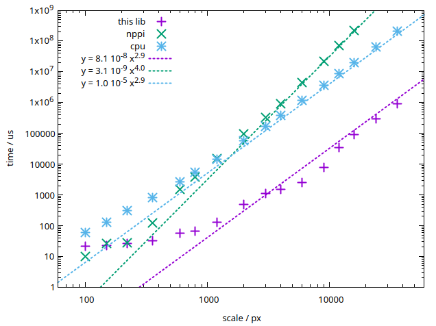

# Efficient Morphology Operations for Binary GPU Images

This library performs morphology operations (dilate, erode, open, close) 
on binary images already stored in CUDA GPU memory.
It is fast even for large dilations because it first packs scanlines into 64 bit words,
1 bit per pixel, and dilates up to 64 pixels simultaneously on every thread
using fast bit-manipulation operation 
and updates up to 64 pixels in every write operation. 
It also skips pixels that can be inferred to have null effect.

I have included some basic tests and benchmarks against a small selection of artificial 
cases. 

The tests compare for pixel-perfect agreement with simple 
'obviously correct' cpu implementation as a reference.

The benchmarks compare against that CPU version and against NVIDIA Performance
Primitives 8-bit dilation because there is no 1-bit dilation and this is the best
NPP option available. This library is orders of magnitude faster than both for all
but the smallest scales.
Let $L$ be the length scale of an image in pixels.

The NPP function scales like $O(L^4)$ because the image area scales
like $O(L^2)$ and the kernel area also scales like $O(L^2)$.

The cpu function scales like $O(L^3)$ because,
although the area scales like $O(L^2)$,
it was built with an optimization that only applies the kernel to
edge pixels, resulting in a scaling of $O(L)$.
This is multiplied by a kernel area scaling of $O(L^2)$.

The new library itself should theoretically have an asymptotic scaling
of $O(L^4)$ (for the same reasons as the NPP function) 
but at these image sizes it scales more like $O(L^3)$.
It could be given a similar optimization as the cpu function to give it a
theoretical asymptotic scaling of $O(L^3)$ but at these image sizes the cost 
would be greater than the benefit.



    scale/px   this/us     nppi/us      cpu/us
         100        21          10          60
         150        23          27         132
         222        26          28         313
         357        32         122         820
         600        58        1521        2621
         800        66        3897        5440
        1200       127       15576       14537
        2000       492       97956       56157
        3000      1119      325921      172246
        4000      1483      908725      388570
        6000      2506     4433405     1192215
        9000      7717    22365172     3622236
       12000     33792    70418324     8650837
       16000     91925   223583269    19656906
       24000    299316           -    64016885
       36000    940711           -   209561028

## How to Build & Run
To build just the library:
```bash
cmake -B build
cmake --build build
```
To build and runtests/benchmarks:
```bash
cmake -B build -DCUDA_MORPHOLOGY_BUILD_TESTS=ON
cmake --build build
build/testing/tests
build/testing/benchmark
```

## Citation / Reference
If you use this in research, please cite:
```
Andrew Jones, "Efficient Morphology Operations for Binary CUDA Images", 2026.
GitHub: https://github.com/apjones-proton/cuda-morph-binary
```
